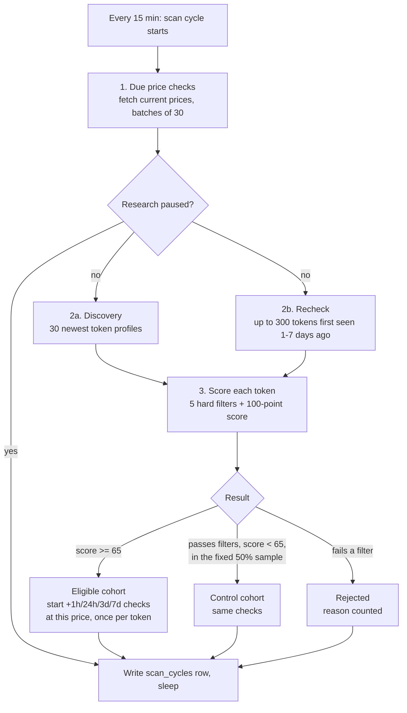

# How Tradebot Works

Current as of 2026-10-19 (strategy version `market_watch_v2`). For operations, deployment and rules for changing the code, see [`CLAUDE.md`](../CLAUDE.md). For the product scope, see [`SOLO_OPERATOR_SCOPE.md`](SOLO_OPERATOR_SCOPE.md).

## In one paragraph

Tradebot is a research instrument, not a trading bot. Every 15 minutes it looks at Solana tokens on Dexscreener, scores each one against a fixed set of rules, and for every token that qualifies it records the price at that moment and checks it again 1 hour, 24 hours, 3 days and 7 days later. It does the same for a comparison group of near-miss tokens and for SOL itself. After enough tokens have been measured, the report answers one question: **do tokens that pass these rules go on to beat comparable tokens and SOL, after costs?** It has no wallet and cannot place a trade.

## Where it runs

| Piece | What it is |
|---|---|
| Render web service `tradebot-managed-staging` | One always-on instance. It runs the scanner in the background and serves the dashboard at https://tradebot-managed-staging.onrender.com (password-protected). |
| Neon Postgres | Every observation, score, price check and scan record. |
| Dexscreener public API | The only market data source. |
| GitHub `GinniNio/Tradebot` | The code. A merge to `main` deploys automatically. |

## The flow

### Step by step

1. **Settle due price checks.** Any check whose time has come (for example a token that qualified 24 hours ago) gets its current price from Dexscreener, along with SOL's price at the same moment. If no valid price arrives within the allowed window, the check is closed as **unresolved** with the reason. No price is ever made up.
2. **Find tokens to look at**, from two sources:
   - **Discovery:** the 30 newest token profiles on Dexscreener. In practice these are almost all tokens under a day old.
   - **Recheck:** up to 300 tokens the bot first saw 1 to 7 days ago, revisited because a token that survives a few days can grow into the liquidity and volume the rules need. A recheck that still fails the filters is only counted, not stored.
3. **Score every token** with the fixed rules (next section).
4. **Act on the result:** start measuring eligible tokens and the sampled near-misses, and count the rejection reasons.
5. **Record the cycle** in `scan_cycles`: how many tokens were scored, passed, qualified or rejected (with reasons), how many checks completed, and any error. The report's "collection" table is built from these rows.

If the service restarts, nothing is lost. Price checks live in the database, and checks abandoned by a crash are picked up again after 10 minutes. During a deploy the new copy waits in standby until the old one releases the scanner lock, so two copies never scan at once.

## The model

There is no machine learning. The "model" is a fixed, readable rule set called `swing_quality`, defined in `tradebot/strategy.py`. Its idea: **pick liquid Solana tokens that are already moving up steadily on heavy, rising trading, without being in a vertical spike.** It is frozen, so the rules can't drift while they're being tested.

### Stage 1: five hard filters (fail any one and the token is out)

| Filter | Requirement | Why |
|---|---|---|
| Liquidity | ≥ $50,000 | Enough depth that a modest position could exit |
| 24h volume | ≥ $100,000 | Real, sustained trading |
| Market cap (FDV if cap unknown) | $250,000 to $25,000,000 | Past micro-cap rug territory, still small enough to move |
| 24h price change | +5% to +120% | Moving up, but not already a blow-off |
| 1h price change | ≤ +25% | Not mid-spike right now |

### Stage 2: a 100-point score (needs ≥ 65)

Each component scales linearly between a floor and a cap, then is capped:

| Component | Points | Floor → full marks |
|---|---|---|
| Liquidity | 30 | $50k → $500k |
| Turnover (24h volume ÷ liquidity) | 25 | 1× → 12× |
| Momentum (24h price change) | 25 | +5% → +80% |
| Volume acceleration (last hour vs the 6h hourly average) | 20 | 0.8× → 2.5× |

### Worked examples (computed with the bot's own code)

| Token | Liquidity | 24h volume | 24h / 1h change | Score | Outcome |
|---|---|---|---|---|---|
| Strong | $500k | $6.0M | +80% / +10% | 30 + 25 + 25 + 20 = **100** | **Eligible**: measurement starts |
| Borderline | $150k | $900k | +40% / +4% | 6.7 + 11.4 + 11.7 + 8.2 = **37.9** | Passes all filters but scores under 65: **control cohort** if in the sample |
| Typical new launch | $18k | $90k | +300% / +60% | 54.1 | **Rejected**: fails all five filters |

The third row is what the discovery feed mostly delivers, which is why so few tokens qualify (see "Where we are").

## The picks

A **pick** is the first moment a token scores 65 or more. At that moment the bot freezes:
- the token's price and the pair it trades on;
- SOL's price;
- the rule version (`market_watch_v2`) and the code commit.

From then on, the token is checked 1 hour, 24 hours, 3 days and 7 days after that moment. Each token counts **once**: if it qualifies again on later scans, nothing new is created, so a token that hangs around can't inflate the sample.

You can see picks in two places:
- **`/report`**: results per cohort and horizon, collection counts, rejection reasons, plus the summary and observations CSV downloads.
- **`/candidates`**: the current top 3 eligible tokens with their score breakdown, and recently rejected tokens with the reasons they failed. The Watch and Reject buttons record your own judgement as a note. They don't affect measurement.

## How we judge the edge

"Edge" here means: **tokens picked by these rules do better than comparable tokens and than holding SOL, by enough to survive trading costs, and they keep doing so.** The report is built to test exactly that.

### The comparisons

- **Eligible vs control.** The control cohort is a fixed half of the tokens that pass all five filters but score under 65. Membership is decided by a hash of the token address before any result is known. If eligible tokens do no better than control, the score adds nothing.
- **Eligible vs SOL.** Each token's return is compared with SOL's return over the same window. If the whole market rose, the picks get no credit for it.
- **Primary horizon: 24 hours.** It was chosen before data arrived and must not be swapped for whichever horizon happens to look best. The 1h, 3d and 7d results are supporting evidence.

### What the report shows, and why

| Measure | Why it's there |
|---|---|
| Median **and** mean | Memecoins produce rare huge winners. A positive mean with a negative median usually means one lucky token. |
| Mean without the top 1 and top 2 tokens, plus the top winner's share of gains | Shows whether the result depends on one outlier |
| Share of tokens losing, worst and best | Shows the typical experience and the tail risk |
| 2% and 5% round-trip cost lines | Price changes aren't trade fills; the edge must survive costs |
| First half vs second half (by discovery time), with counts | Shows whether the result holds over time or came from one burst |
| Median by discovery day | Exposes a single good or bad day driving the result |
| Unresolved checks, and a conservative line counting them as -100% | Dead or delisted tokens can't quietly disappear from the results |

### What would count as promising

All of these at once, on the 24-hour horizon:
1. The median and the mean are both positive after costs.
2. Both beat SOL and the control cohort.
3. The result survives dropping the top one or two tokens.
4. It holds in both halves of the period.
5. Enough tokens: at least 30 eligible tokens, measured going forward.

Even then the next step isn't trading. It is quote-only checks: asking Jupiter what a buy and a later sell would actually have returned, on a fresh batch of picks, still with no wallet. Rules may not be tuned against data already seen. A changed rule needs a new version and a fresh measurement period.

## Where we are (2026-10-19)

- **Supply is the bottleneck.** Under v1, 30 days of scanning (7,270 scored rows) produced 1 eligible token. v2 adds the 1–7 day recheck and automatic measurement. **The 7-day checkpoint on about 2026-10-26** reviews how many tokens qualify and why the rest fail. It is not a profit verdict.
- **What the old bot learned.** Read-only analysis of its backups, 2026-10-19, on 24h median returns, first signal per token:

  | Old strategy | Tokens | Median | Share positive |
  |---|---|---|---|
  | launch_momentum | 5,131 | -97% | 4% |
  | zombie_revival | 438 | -77% | 16% |
  | zombie_revival_v2 | 95 | -18% | 37% |

  Of the 7,789 tokens the old bot tracked, only 667 are still listed, and none passes today's filters.

  The lesson behind the current design: young and revived memecoins mostly go to zero. That's why `swing_quality` requires liquidity, sustained volume and a measured rise. It's also why, if the checkpoint shows the new-token feed can't supply qualifying tokens, the next change should be a discovery source of **established** tokens, not looser filters.
- **Deadline:** if no strategy shows repeatable, cost-aware edge by **2026-12-31**, the project is archived or scaled down.
